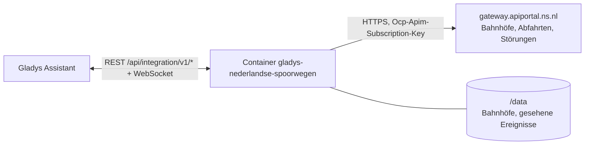
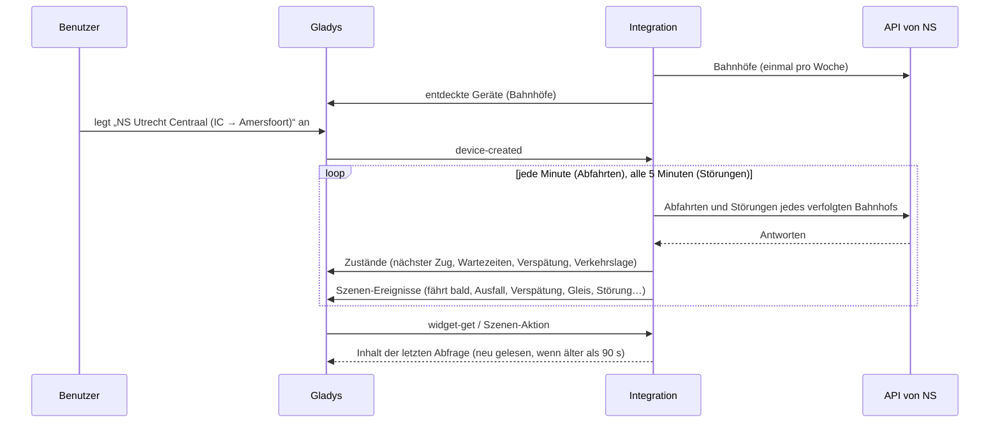
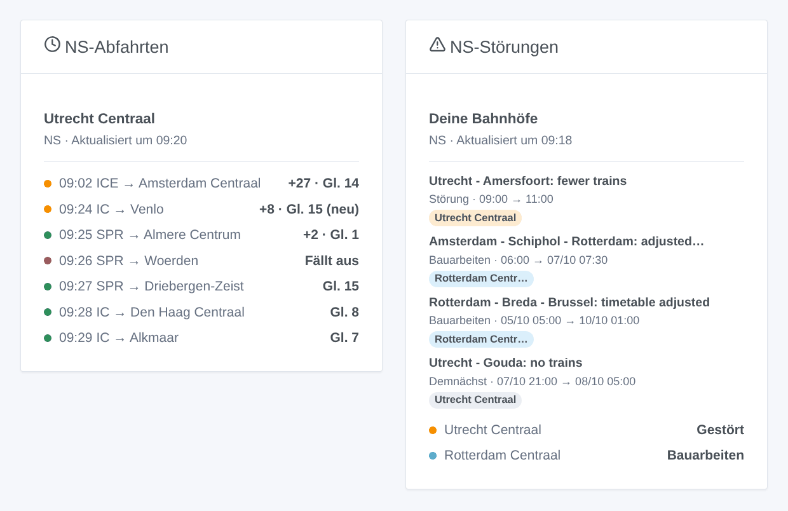

# Gladys Nederlandse Spoorwegen

[English](README.md) · [Français](README.fr.md) · **Deutsch** · [Español](README.es.md)

[](LICENSE)
[](https://github.com/William-De71/gladys-nederlandse-spoorwegen/releases)
[](https://github.com/William-De71/gladys-nederlandse-spoorwegen/actions/workflows/release.yml)
[](https://gladysassistant.com)


Externe Integration für [Gladys Assistant](https://gladysassistant.com) für **NS**, die niederländische Bahn: die nächsten Züge deiner Bahnhöfe in Echtzeit, mit Verspätung, Gleis und ausgefallenen Zügen, sowie die Störungen und Bauarbeiten an deinen Bahnhöfen, mit Szenen und Dashboard-Widgets. Sie liest die offizielle API von NS mit deinem kostenlosen persönlichen Schlüssel.

Benutzerdokumentation: [English](docs/en.md) · [Français](docs/fr.md) · [Deutsch](docs/de.md) · [Español](docs/es.md).

> Community-Integration, weder mit NS (Nederlandse Spoorwegen) verbunden noch von ihr unterstützt.

## Funktionen

- **Ein Gerät pro verfolgtem Bahnhof** (drei im Formular, bis zu 10 weitere mit der Schaltfläche **Bahnhof hinzufügen**), per Code („UT“, „ASD“) oder Name eingegeben und nach **Zuggattung** („IC“, „SPR“) und **Richtung** (Ziel oder ein Bahnhof, an dem der Zug hält) gefiltert: nächster Zug mit Verspätung und Gleis, Wartezeit der nächsten zwei Züge, Verspätung des nächsten.
- **Die Störungen jedes Bahnhofs** auf seinem Gerät: Störungen, Bauarbeiten und Notlagen in einer Zeile und ihre laufende Anzahl.
- **Echtzeit**: erwartete Zeit und Verspätung, wie NS sie liefert, Gleiswechsel, ausgefallene Züge.
- **6 Szenen-Auslöser**, **2 Szenen-Aktionen** und **2 Dashboard-Widgets** (siehe unten).
- Eine Anfrage pro verfolgtem Bahnhof, standardmäßig jede Minute (30 s bis 5 min, nachts alle 10 min, wenn kein Zug angekündigt ist), Störungen alle 5 Minuten, immer unter den 300 Anfragen pro 5 Minuten, die NS erlaubt; die Bahnhöfe von NS werden in `/data` gespeichert.
- Konfigurationsschaltflächen: Verbindung testen, Bahnhof suchen (mit Code), Bahnhöfe hinzufügen / entfernen / auflisten, Diagnose.
- Vier Sprachen überall: Englisch, Französisch, Deutsch, Spanisch.

## Funktionsweise




Beim Start liest die Integration die Bahnhöfe von NS (`/nsapp-stations/v3`) und löst deine Eingaben auf: „UT“, „Utrecht“ oder „Utrecht Centraal“ ist der Bahnhof `UT`, „Den Bosch“ der Bahnhof `HT`. Dann liest sie die nächsten Abfahrten jedes verfolgten Bahnhofs (`/reisinformatie-api/api/v2/departures`) in ihrem eigenen Takt, eine Anfrage pro Bahnhof, und behält die Züge der gewählten Gattungen und Richtung; alle 5 Minuten liest sie die Störungen jedes Bahnhofs (`/disruptions/v3/station/<code>`). Jede Abfrage wird mit der vorherigen verglichen, um die Szenen-Auslöser auszulösen.



### Transport

Nur Cloud (`"transports": ["cloud"]`): Der Katalog zeigt das Cloud-Abzeichen. Die Integration kontaktiert `gateway.apiportal.ns.nl` mit deinem Schlüssel; nur die verfolgten Bahnhöfe werden abgefragt. Es gibt keinen lokalen Zugang und daher keine Schaltfläche „Lokale Verbindung bevorzugen“.

## Geräte und Funktionen

| Gerät          | Funktion                           | Kategorie / Typ              | Werte                                                       |
| -------------- | ---------------------------------- | ---------------------------- | ----------------------------------------------------------- |
| NS \<Bahnhof\> | Nächster Zug                       | `text` / `text`              | „IC 3529 → Venlo · 11 Min. (+8 Min. Verspätung) · Gleis 15“ |
| NS \<Bahnhof\> | Wartezeit, Wartezeit des folgenden | `duration` / `integer`       | 0 … 180 min                                                 |
| NS \<Bahnhof\> | Verspätung                         | `duration` / `integer`       | 0 … 180 min                                                 |
| NS \<Bahnhof\> | Verkehrslage                       | `text` / `text`              | „Gestört: Utrecht - Amersfoort: fewer trains“               |
| NS \<Bahnhof\> | Laufende Störungen                 | `counter-sensor` / `integer` | 0 … 20                                                      |

Nachts, ohne Zug, behalten die Wartezeiten ihren letzten Wert (eine 0 würde einen Zug jetzt ankündigen); die Verspätung wird nur veröffentlicht, wenn NS eine erwartete Zeit liefert.

## Szenen-Auslöser, Aktionen und Widgets



**Szenen-Auslöser** (einmal pro Übergang; die erste Abfrage dient als Referenz und löst nichts aus):

- **Zug fährt bald ab**: Ein Zug eines verfolgten Bahnhofs fährt in 2, 5, 10, 15, 20 oder 30 Minuten ab, nach seiner erwarteten Zeit. Filter: Bahnhof, Minuten.
- **Zug fällt aus**: Ein Zug der nächsten zwei Stunden an einem verfolgten Bahnhof fällt aus. Filter: Bahnhof.
- **Zug verspätet**: Die Verspätung eines Zuges der nächsten zwei Stunden erreicht 5, 10, 15 oder 30 Minuten. Filter: Bahnhof, erreichte Verspätung.
- **Gleiswechsel**: Ein Zug der nächsten zwei Stunden fährt von einem anderen Gleis ab. Filter: Bahnhof.
- **Störung an einem Bahnhof**: Eine Störung, Bauarbeiten oder eine Notlage an einem verfolgten Bahnhof beginnt. Filter: Bahnhof, Art.
- **Störung beendet**: Sie ist vorbei. Filter: Bahnhof, Art.

**Szenen-Aktionen**: **nächste Züge** eines Bahnhofs (Zug, Ziel, Wartezeit, Uhrzeit, Gleis, Verspätung, der folgende, ein Satz) und **Störungen eines Bahnhofs** (Zustand, Anzahl, Titel, Details, ein Satz).

**Widgets**: **NS-Abfahrten** (ein verfolgter Bahnhof, mehrere in einer Liste oder ein beliebiger, in den Einstellungen eingegebener Bahnhof) und **NS-Störungen** (deine Bahnhöfe oder das ganze niederländische Netz).

Beispiele:

- Wenn **der Intercity nach Amersfoort in 10 Minuten in Utrecht Centraal abfährt** → die Flurlampe grün einschalten.
- Wenn **dein Zug ausfällt**, **15 Minuten Verspätung hat** oder **auf ein anderes Gleis wechselt** → `{{triggerEvent.data.summary}}` an dein Telefon senden.
- Jeden Werktag um 7:30 → **die nächsten Züge** deines Bahnhofs **lesen** und die `summary` vom Küchenlautsprecher sprechen lassen.

## Voraussetzungen

- Gladys Assistant **5.3.0** oder neuer (Widgets und Szenen-Auslöser externer Integrationen, Katalog-Schlüsselwörter und -Länder von Gladys 5.3). Ältere Instanzen können die Integration nicht installieren.
- Ein kostenloser persönlicher Schlüssel der NS-API: Lege ein Konto im [NS-API-Portal](https://apiportal.ns.nl/) an, abonniere das Produkt **Ns-App** (kostenlos) und kopiere seinen Primärschlüssel.

## Installation

- **Aus dem Store** von Gladys (Integrationen → Externe Integrationen), mit einem Klick, sobald indexiert.
- **Über die URL des Repositorys**: `https://github.com/William-De71/gladys-nederlandse-spoorwegen`.
- **Entwicklermodus**: das Image lokal bauen (`docker build -t gladys-nederlandse-spoorwegen .`) und aus Gladys installieren.

## Konfiguration

| Feld                 | Beschreibung                                                                                     |
| -------------------- | ------------------------------------------------------------------------------------------------ |
| API-Schlüssel        | Der Primärschlüssel deines „Ns-App“-Abonnements (geheim).                                        |
| Bahnhof (1 bis 3)    | Ein Code („UT“, „ASD“) oder ein Name („Utrecht Centraal“, „Den Bosch“).                          |
| Zuggattungen         | „IC“, „SPR“, „IC \| ICE“. Leer: alle Züge.                                                       |
| Richtung             | Bahnhöfe, zu denen der Zug fährt oder an denen er hält: „Amersfoort \| Zwolle“. Leer: alle Züge. |
| Abfrage der Bahnhöfe | 30 s, 1 min (Standard), 2 min oder 5 min.                                                        |
| Sprache der Texte    | Namen der Geräte, Zusammenfassungen und Ausgaben der Szenen.                                     |

Schaltflächen: **Verbindung testen**, **Bahnhof suchen** (Name und Code jedes gefundenen Bahnhofs), **Bahnhof hinzufügen**, **Bahnhof entfernen**, **Bahnhöfe auflisten** (die Bahnhöfe über die drei des Formulars hinaus, in der Gladys-Konfiguration gespeichert) und **Diagnose** (schreibt Bahnhöfe, letzte Züge, Störungen, Fehler und Anfragen in den Tab Protokolle, nie den Schlüssel).

## Verwendung

1. Gib deinen API-Schlüssel und einen bis drei Bahnhöfe ein — mehr mit **Bahnhof hinzufügen** — (bei Bedarf mit Zuggattungen und Richtung) und speichere.
2. Lege im Tab **Entdecken** die Geräte „NS …“ an.
3. Füge die Widgets **NS-Abfahrten** und **NS-Störungen** einem Dashboard hinzu und baue Szenen mit den Auslösern oben.

## Entwicklung

```bash
npm install
npm test                       # node --test, nie mit dem Netzwerk
npm run lint && npm run format:check
npx github:GladysAssistant/integration-store . --skip-image-check
scripts/build-cover.sh         # cover.jpg aus docs/assets/cover.svg
docs/illustrations/render.sh   # docs/assets/widgets.<lang>.png
node .github/scripts/release.mjs next
```

Lokal liest das SDK `GLADYS_HOST_API_URL`, `GLADYS_INTEGRATION_TOKEN` und `GLADYS_INTEGRATION_SELECTOR`; `NS_API_URL` lenkt die Integration auf ein anderes Gateway (einen Mock); `DEBUG=gladys-integration-sdk` zeigt die SDK-Protokolle und prüft jeden Widget-Inhalt. Die Tests nutzen echte, gekürzte Antworten der NS-API (`test/fixtures/`, aufgezeichnet vom Projekt [perron](https://github.com/ultimatelemon/perron), MIT). Die Regeln des Projekts stehen in [CLAUDE.md](CLAUDE.md).

## Veröffentlichungsprozess


Jeder Merge auf `main` startet die CI und berechnet dann die Version aus den [Conventional Commits](https://www.conventionalcommits.org/) seit dem letzten Tag: `feat` → Minor, `fix` / `perf` → Patch, `!` oder `BREAKING CHANGE` → Major (unter 1.0.0 ein Minor); `docs`, `chore`, `ci`, `test`, `style`, `refactor`, `build` allein veröffentlichen nichts. Der Changelog-Abschnitt wird erzeugt, der Tag gepusht, das Multi-Architektur-Image gebaut, dann erhält `main` den Release-Commit, das GitHub Release wird angelegt und ein letzter Job prüft das öffentliche Image, den Store-Validator und das Topic.

- Der Titel des Pull Requests wird zum Squash-Commit und dann zur Changelog-Zeile: Schreibe ihn auf Englisch, für den Benutzer (`pr-title.yml` prüft ihn). Bearbeite `CHANGELOG.md` nie von Hand.
- 1.0.0 ist eine Entscheidung: Actions → Release → Run workflow mit `release-as: 1.0.0`. `dry-run` zeigt Version und Notizen, ohne zu veröffentlichen.
- **Geschützter Branch**: Das Release pusht seinen Commit mit `GITHUB_TOKEN` auf `main`. Mit einem Ruleset auf `main`, das strenger ist als „kein Löschen, kein Force-Push“, füge GitHub Actions seiner Bypass-Liste hinzu (oder pushe über eine GitHub App), sonst schlägt der Veröffentlichungsjob mit Hinweisen fehl.
- Mache nach dem ersten Release das Paket auf `ghcr.io` öffentlich (Package settings → Change visibility), sonst kann Gladys es nicht laden.

## Fehlerbehebung

Siehe [docs/de.md](docs/de.md#fehlerbehebung). Melde Probleme mit den Versionen von Gladys und der Integration, dem betroffenen Bahnhof und den Zeilen der Schaltfläche **Diagnose**.

## Mitwirken

Issues und Pull Requests sind willkommen. Führe `npm run format:check && npm run lint && npm test` aus, bevor du einen Pull Request öffnest, und ändere keine externe ID und keinen gespeicherten Schlüssel (siehe [CLAUDE.md](CLAUDE.md)).

## Sicherheit

Siehe [SECURITY.md](SECURITY.md): Melde Schwachstellen vertraulich. Der API-Schlüssel wird von Gladys als Geheimnis gespeichert, nur an das Gateway von NS gesendet und nie protokolliert; die Integration läuft schreibgeschützt und ohne Root-Rechte in ihrem Container.

## Kommende Screenshots

Die Bilder oben sind Illustrationen, keine Screenshots. Echte Screenshots kommen nach `docs/assets/screenshots/` (PNG, 1280 × 800): `configuration.png`, `discovery.png`, `device.png`, `scene.png`.

## Lizenz

[Apache License 2.0](LICENSE) — siehe auch [NOTICE](NOTICE). Die Bahnhöfe, Abfahrten und Störungen stammen aus der offiziellen API von NS, gelesen mit deinem eigenen Schlüssel nach den Nutzungsbedingungen des NS-API-Portals: Die Widgets zeigen die Quelle und die Uhrzeit jeder Abfrage. Danke an die Dokumentation und das SDK von Gladys und an NS für ihre offene API.
