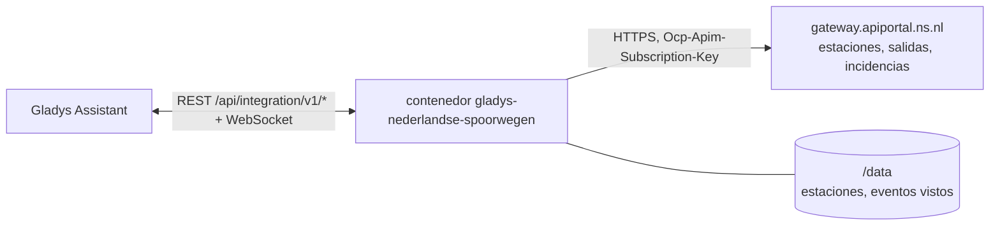
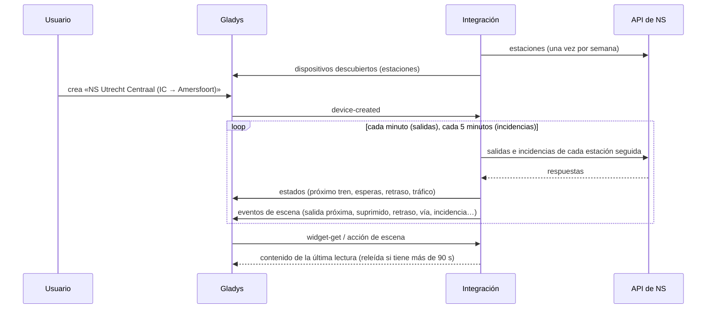
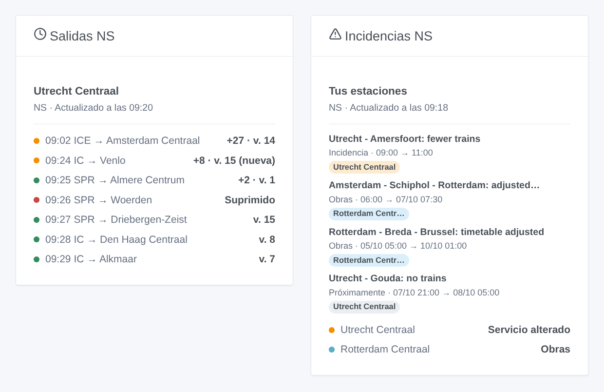

# Gladys Nederlandse Spoorwegen

[English](README.md) · [Français](README.fr.md) · [Deutsch](README.de.md) · **Español**

[](LICENSE)
[](https://github.com/William-De71/gladys-nederlandse-spoorwegen/releases)
[](https://github.com/William-De71/gladys-nederlandse-spoorwegen/actions/workflows/release.yml)
[](https://gladysassistant.com)


Integración externa de [Gladys Assistant](https://gladysassistant.com) para **NS**, los ferrocarriles neerlandeses: los próximos trenes de tus estaciones en tiempo real, con su retraso, su vía y los suprimidos, y las incidencias y obras que afectan a tus estaciones, con escenas y widgets de panel. Lee la API oficial de NS con tu clave personal gratuita.

Documentación de usuario: [English](docs/en.md) · [Français](docs/fr.md) · [Deutsch](docs/de.md) · [Español](docs/es.md).

> Integración comunitaria, sin afiliación con NS (Nederlandse Spoorwegen) ni respaldo de su parte.

## Funciones

- **Un dispositivo por estación seguida** (tres en el formulario, hasta 10 más con el botón **Añadir una estación**), indicada por código («UT», «ASD») o por nombre, y filtrada por **tipo de tren** («IC», «SPR») y **dirección** (el destino o una estación en la que para el tren): próximo tren con su retraso y su vía, espera de los dos próximos trenes, retraso del próximo.
- **Las incidencias de cada estación** en su dispositivo: incidencias, obras y alertas, en una línea, y su número en curso.
- **Tiempo real**: la hora estimada y el retraso tal como los da NS, los cambios de vía, los trenes suprimidos.
- **6 disparadores de escena**, **2 acciones de escena** y **2 widgets de panel** (abajo).
- Una petición por estación seguida, cada minuto por defecto (30 s a 5 min, cada 10 min de noche cuando no se anuncia ningún tren), incidencias cada 5 minutos, siempre por debajo de las 300 peticiones cada 5 minutos que permite NS; las estaciones de NS se guardan en `/data`.
- Botones de configuración: probar la conexión, buscar una estación (con su código), añadir / quitar / listar estaciones, diagnóstico.
- Cuatro idiomas en todas partes: inglés, francés, alemán, español.

## Funcionamiento




Al arrancar, la integración lee las estaciones de NS (`/nsapp-stations/v3`) y resuelve lo que has escrito: «UT», «Utrecht» o «Utrecht Centraal» es la estación `UT`, «Den Bosch» la estación `HT`. Después lee las próximas salidas de cada estación seguida (`/reisinformatie-api/api/v2/departures`) a su propio ritmo, una petición por estación, y conserva los trenes de los tipos y la dirección elegidos; cada 5 minutos lee las incidencias de cada estación (`/disruptions/v3/station/<code>`). Cada lectura se compara con la anterior para lanzar los disparadores de escena.



### Transporte

Solo nube (`"transports": ["cloud"]`): el catálogo muestra la insignia de nube. La integración contacta con `gateway.apiportal.ns.nl` con tu clave; solo se piden las estaciones seguidas. No existe acceso local, así que no hay botón «Preferir la conexión local».

## Dispositivos y funciones

| Dispositivo     | Función                      | Categoría / tipo             | Valores                                                 |
| --------------- | ---------------------------- | ---------------------------- | ------------------------------------------------------- |
| NS \<estación\> | Próximo tren                 | `text` / `text`              | «IC 3529 → Venlo · 11 min (+8 min de retraso) · vía 15» |
| NS \<estación\> | Espera, espera del siguiente | `duration` / `integer`       | 0 … 180 min                                             |
| NS \<estación\> | Retraso                      | `duration` / `integer`       | 0 … 180 min                                             |
| NS \<estación\> | Tráfico                      | `text` / `text`              | «Servicio alterado: Utrecht - Amersfoort: fewer trains» |
| NS \<estación\> | Incidencias en curso         | `counter-sensor` / `integer` | 0 … 20                                                  |

De noche, sin ningún tren, las esperas conservan su último valor (un 0 anunciaría un tren ahora); el retraso solo se publica cuando NS da una hora estimada.

## Disparadores, acciones de escena y widgets



**Disparadores de escena** (una vez por transición; la primera lectura sirve de referencia y no lanza nada):

- **Tren a punto de salir**: un tren de una estación seguida sale dentro de 2, 5, 10, 15, 20 o 30 minutos, según su hora estimada. Filtros: estación, minutos.
- **Tren suprimido**: un tren de las dos próximas horas en una estación seguida se suprime. Filtro: estación.
- **Tren con retraso**: el retraso de un tren de las dos próximas horas llega a 5, 10, 15 o 30 minutos. Filtros: estación, retraso alcanzado.
- **Cambio de vía**: un tren de las dos próximas horas sale de otra vía. Filtro: estación.
- **Incidencia en una estación**: empieza una incidencia, unas obras o una alerta que afecta a una estación seguida. Filtros: estación, tipo.
- **Fin de incidencia**: ha terminado. Filtros: estación, tipo.

**Acciones de escena**: **próximos trenes** de una estación (tren, destino, espera, hora, vía, retraso, el siguiente, una frase) e **incidencias de una estación** (estado, número, título, detalles, una frase).

**Widgets**: **Salidas NS** (una estación seguida, varias en una misma lista o cualquier estación escrita en los ajustes) e **Incidencias NS** (tus estaciones o toda la red neerlandesa).

Ejemplos:

- Cuando **el Intercity a Amersfoort sale de Utrecht Centraal dentro de 10 minutos** → encender en verde la lámpara de la entrada.
- Cuando **tu tren se suprime**, **lleva 15 minutos de retraso** o **cambia de vía** → enviar `{{triggerEvent.data.summary}}` a tu teléfono.
- Cada día laborable a las 7:30 → **leer los próximos trenes** de tu estación y que el altavoz de la cocina diga el `summary`.

## Requisitos

- Gladys Assistant **5.3.0** o posterior (widgets y disparadores de escena de las integraciones externas, palabras clave y países del catálogo de Gladys 5.3). Las instancias más antiguas no pueden instalar la integración.
- Una clave personal gratuita de la API de NS: crea una cuenta en el [portal de API de NS](https://apiportal.ns.nl/), suscríbete al producto **Ns-App** (gratuito) y copia su clave principal.

## Instalación

- **Desde la tienda** de Gladys (Integraciones → Integraciones externas), con un clic, una vez indexada.
- **Desde la URL del repositorio**: `https://github.com/William-De71/gladys-nederlandse-spoorwegen`.
- **Modo desarrollador**: construye la imagen en local (`docker build -t gladys-nederlandse-spoorwegen .`) e instálala desde Gladys.

## Configuración

| Campo                     | Descripción                                                                                         |
| ------------------------- | --------------------------------------------------------------------------------------------------- |
| Clave de API              | La clave principal de tu suscripción «Ns-App» (secreta).                                            |
| Estación (1 a 3)          | Un código («UT», «ASD») o un nombre («Utrecht Centraal», «Den Bosch»).                              |
| Tipos de tren             | «IC», «SPR», «IC \| ICE». Vacío: todos los trenes.                                                  |
| Dirección                 | Estaciones a las que va el tren o en las que para: «Amersfoort \| Zwolle». Vacío: todos los trenes. |
| Lectura de las estaciones | 30 s, 1 min (por defecto), 2 min o 5 min.                                                           |
| Idioma de los textos      | Nombres de los dispositivos, resúmenes y salidas de las escenas.                                    |

Botones: **Probar la conexión**, **Buscar una estación** (nombre y código de cada estación encontrada), **Añadir una estación**, **Quitar una estación**, **Listar las estaciones** (las estaciones además de las tres del formulario, guardadas en la configuración de Gladys) y **Diagnóstico** (escribe las estaciones, los últimos trenes, las incidencias, los errores y las peticiones en la pestaña Registros, nunca la clave).

## Uso

1. Introduce tu clave de API y de una a tres estaciones — más con **Añadir una estación** — (con sus tipos de tren y su dirección si quieres) y guarda.
2. En la pestaña **Descubrir**, crea los dispositivos «NS …».
3. Añade los widgets **Salidas NS** e **Incidencias NS** a un panel, y crea escenas con los disparadores de arriba.

## Desarrollo

```bash
npm install
npm test                       # node --test, nunca toca la red
npm run lint && npm run format:check
npx github:GladysAssistant/integration-store . --skip-image-check
scripts/build-cover.sh         # cover.jpg a partir de docs/assets/cover.svg
docs/illustrations/render.sh   # docs/assets/widgets.<lang>.png
node .github/scripts/release.mjs next
```

En local, el SDK lee `GLADYS_HOST_API_URL`, `GLADYS_INTEGRATION_TOKEN` y `GLADYS_INTEGRATION_SELECTOR`; `NS_API_URL` dirige la integración a otra pasarela (un simulador); `DEBUG=gladys-integration-sdk` muestra los registros del SDK y comprueba cada contenido de widget. Las pruebas usan respuestas reales de la API de NS, reducidas (`test/fixtures/`, grabadas por el proyecto [perron](https://github.com/ultimatelemon/perron), MIT). Las reglas del proyecto están en [CLAUDE.md](CLAUDE.md).

## Proceso de publicación


Cada fusión en `main` lanza la CI y luego calcula la versión a partir de los [Conventional Commits](https://www.conventionalcommits.org/) desde la última etiqueta: `feat` → menor, `fix` / `perf` → parche, `!` o `BREAKING CHANGE` → mayor (una menor antes de 1.0.0); `docs`, `chore`, `ci`, `test`, `style`, `refactor`, `build` por sí solos no publican nada. Se genera la sección del changelog, se sube la etiqueta, se construye la imagen multiarquitectura, después `main` recibe el commit de publicación, se crea la GitHub Release y un último job comprueba la imagen pública, el validador de la tienda y el topic.

- El título de la pull request se convierte en el commit squash y luego en la línea del changelog: escríbelo en inglés, para el usuario (`pr-title.yml` lo comprueba). No edites nunca `CHANGELOG.md` a mano.
- La 1.0.0 es una decisión: Actions → Release → Run workflow con `release-as: 1.0.0`. `dry-run` muestra la versión y las notas sin publicar nada.
- **Rama protegida**: la publicación sube su commit a `main` con `GITHUB_TOKEN`. Con un ruleset en `main` más estricto que «ni borrado ni force-push», añade GitHub Actions a su lista de excepciones (o sube mediante una GitHub App); si no, el job de publicación falla con instrucciones.
- Tras la primera publicación, haz público el paquete de `ghcr.io` (Package settings → Change visibility), o Gladys no podrá descargarlo.

## Solución de problemas

Consulta [docs/es.md](docs/es.md#solución-de-problemas). Informa de los problemas con las versiones de Gladys y de la integración, la estación afectada y las líneas del botón **Diagnóstico**.

## Contribuir

Las issues y pull requests son bienvenidas. Ejecuta `npm run format:check && npm run lint && npm test` antes de abrir una pull request, y no cambies ningún identificador externo ni ninguna clave guardada (consulta [CLAUDE.md](CLAUDE.md)).

## Seguridad

Consulta [SECURITY.md](SECURITY.md): informa de las vulnerabilidades en privado. Gladys guarda la clave de API como secreto, solo se envía a la pasarela de NS y nunca se escribe en los registros; la integración funciona en solo lectura, sin ser root, en su contenedor.

## Capturas pendientes

Las imágenes de arriba son ilustraciones, no capturas de pantalla. Las capturas reales irán en `docs/assets/screenshots/` (PNG, 1280 × 800): `configuration.png`, `discovery.png`, `device.png`, `scene.png`.

## Licencia

[Apache License 2.0](LICENSE) — consulta también [NOTICE](NOTICE). Las estaciones, salidas e incidencias proceden de la API oficial de NS, leída con tu propia clave según las condiciones de uso del portal de API de NS: los widgets indican la fuente y la hora de cada lectura. Gracias a la documentación y al SDK de Gladys, y a NS por su API abierta.
