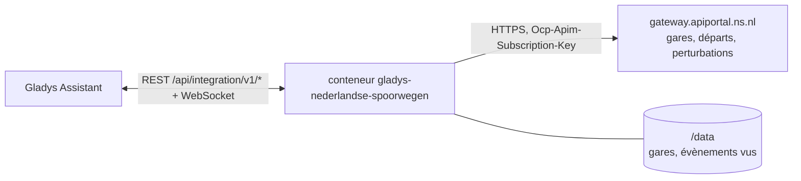
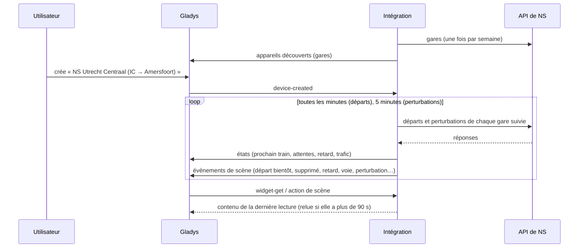
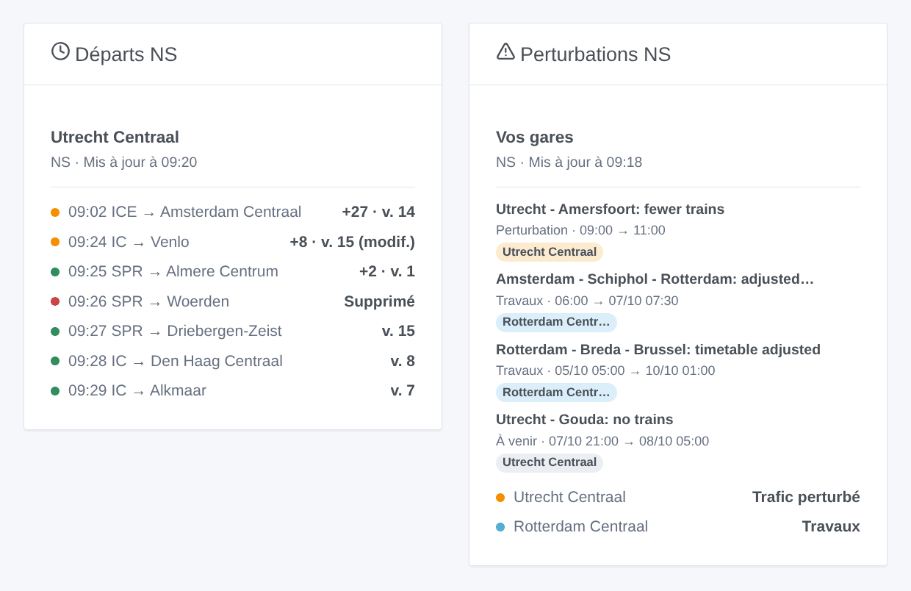

# Gladys Nederlandse Spoorwegen

[English](README.md) · **Français** · [Deutsch](README.de.md) · [Español](README.es.md)

[](LICENSE)
[](https://github.com/William-De71/gladys-nederlandse-spoorwegen/releases)
[](https://github.com/William-De71/gladys-nederlandse-spoorwegen/actions/workflows/release.yml)
[](https://gladysassistant.com)


Intégration externe de [Gladys Assistant](https://gladysassistant.com) pour **NS**, les chemins de fer néerlandais : les prochains trains de vos gares en temps réel, avec leur retard, leur voie et les trains supprimés, et les perturbations et travaux qui touchent vos gares, avec scènes et widgets de tableau de bord. Elle lit l’API officielle de NS avec votre clé personnelle gratuite.

Documentation utilisateur : [English](docs/en.md) · [Français](docs/fr.md) · [Deutsch](docs/de.md) · [Español](docs/es.md).

> Intégration communautaire, ni affiliée à NS (Nederlandse Spoorwegen) ni approuvée par elle.

## Fonctionnalités

- **Un appareil par gare suivie** (trois dans le formulaire, jusqu’à 10 de plus avec le bouton **Ajouter une gare**), saisie par code (« UT », « ASD ») ou par nom, et filtrée par **type de train** (« IC », « SPR ») et **direction** (la destination ou une gare où le train s’arrête) : prochain train avec son retard et sa voie, attente des deux prochains trains, retard du prochain.
- **Les perturbations de chaque gare** sur son appareil : perturbations, travaux et alertes, en une ligne, et leur nombre en cours.
- **Temps réel** : l’heure estimée et le retard tels que NS les donne, les changements de voie, les trains supprimés.
- **6 déclencheurs de scène**, **2 actions de scène** et **2 widgets** (ci-dessous).
- Une requête par gare suivie, toutes les minutes par défaut (30 s à 5 min, toutes les 10 min la nuit quand aucun train n’est annoncé), perturbations toutes les 5 minutes, toujours sous les 300 requêtes par 5 minutes autorisées par NS ; les gares de NS gardées dans `/data`.
- Boutons de configuration : tester la connexion, chercher une gare (avec son code), ajouter / retirer / lister des gares, diagnostic.
- Quatre langues partout : anglais, français, allemand, espagnol.

## Fonctionnement




Au démarrage, l’intégration lit les gares de NS (`/nsapp-stations/v3`) et résout ce que vous avez saisi : « UT », « Utrecht » ou « Utrecht Centraal » désignent la gare `UT`, « Den Bosch » la gare `HT`. Puis elle lit les prochains départs de chaque gare suivie (`/reisinformatie-api/api/v2/departures`) à son propre rythme, une requête par gare, et garde les trains des types et de la direction choisis ; toutes les 5 minutes, elle lit les perturbations de chaque gare (`/disruptions/v3/station/<code>`). Chaque lecture est comparée à la précédente pour déclencher les scènes.



### Transport

Cloud uniquement (`"transports": ["cloud"]`) : le catalogue affiche le badge cloud. L’intégration contacte `gateway.apiportal.ns.nl` avec votre clé ; seules les gares suivies sont demandées. Il n’existe pas d’accès local, donc pas de bouton « Préférer la connexion locale ».

## Appareils et fonctionnalités

| Appareil    | Fonctionnalité              | Catégorie / type             | Valeurs                                                   |
| ----------- | --------------------------- | ---------------------------- | --------------------------------------------------------- |
| NS \<gare\> | Prochain train              | `text` / `text`              | « IC 3529 → Venlo · 11 min (+8 min de retard) · voie 15 » |
| NS \<gare\> | Attente, attente du suivant | `duration` / `integer`       | 0 … 180 min                                               |
| NS \<gare\> | Retard                      | `duration` / `integer`       | 0 … 180 min                                               |
| NS \<gare\> | Trafic                      | `text` / `text`              | « Trafic perturbé : Utrecht - Amersfoort: fewer trains »  |
| NS \<gare\> | Perturbations en cours      | `counter-sensor` / `integer` | 0 … 20                                                    |

La nuit, sans aucun train, les attentes gardent leur dernière valeur (un 0 annoncerait un train tout de suite) ; le retard n’est publié que quand NS donne une heure estimée.

## Déclencheurs, actions de scène et widgets



**Déclencheurs de scène** (une fois par transition ; la première lecture sert de référence et ne déclenche rien) :

- **Train bientôt au départ** : un train d’une gare suivie part dans 2, 5, 10, 15, 20 ou 30 minutes, d’après son heure estimée. Filtres : gare, minutes.
- **Train supprimé** : un train des deux prochaines heures d’une gare suivie est supprimé. Filtre : gare.
- **Train en retard** : le retard d’un train des deux prochaines heures atteint 5, 10, 15 ou 30 minutes. Filtres : gare, retard atteint.
- **Changement de voie** : un train des deux prochaines heures part d’une autre voie. Filtre : gare.
- **Perturbation à une gare** : une perturbation, des travaux ou une alerte concernant une gare suivie commence. Filtres : gare, type.
- **Fin de perturbation** : elle est terminée. Filtres : gare, type.

**Actions de scène** : **prochains trains** d’une gare (train, destination, attente, heure, voie, retard, le suivant, une phrase) et **perturbations d’une gare** (état, nombre, titre, détails, une phrase).

**Widgets** : **Départs NS** (une gare suivie, plusieurs dans une même liste, ou n’importe quelle gare saisie dans les réglages) et **Perturbations NS** (vos gares, ou tout le réseau néerlandais).

Exemples :

- Quand **l’Intercity pour Amersfoort part d’Utrecht Centraal dans 10 minutes** → allumer la lampe de l’entrée en vert.
- Quand **votre train est supprimé**, **a 15 minutes de retard** ou **change de voie** → envoyer `{{triggerEvent.data.summary}}` sur votre téléphone.
- Chaque jour de semaine à 7 h 30 → **lire les prochains trains** de votre gare et faire dire le `summary` par l’enceinte de la cuisine.

## Prérequis

- Gladys Assistant **5.3.0** ou plus récent (widgets et déclencheurs de scène des intégrations externes, mots-clés et pays du catalogue de Gladys 5.3). Les instances plus anciennes ne peuvent pas installer l’intégration.
- Une clé personnelle gratuite de l’API NS : créez un compte sur le [portail API de NS](https://apiportal.ns.nl/), abonnez-vous au produit **Ns-App** (gratuit) et copiez sa clé primaire.

## Installation

- **Depuis le store** de Gladys (Intégrations → Intégrations externes), en un clic, une fois indexée.
- **Depuis l’URL du dépôt** : `https://github.com/William-De71/gladys-nederlandse-spoorwegen`.
- **Mode développeur** : construisez l’image en local (`docker build -t gladys-nederlandse-spoorwegen .`) et installez-la depuis Gladys.

## Configuration

| Champ             | Description                                                                                |
| ----------------- | ------------------------------------------------------------------------------------------ |
| Clé d’API         | La clé primaire de votre abonnement « Ns-App » (secrète).                                  |
| Gare (1 à 3)      | Un code (« UT », « ASD ») ou un nom (« Utrecht Centraal », « Den Bosch »).                 |
| Types de train    | « IC », « SPR », « IC \| ICE ». Vide : tous les trains.                                    |
| Direction         | Gares où va le train ou où il s’arrête : « Amersfoort \| Zwolle ». Vide : tous les trains. |
| Lecture des gares | 30 s, 1 min (par défaut), 2 min ou 5 min.                                                  |
| Langue des textes | Noms des appareils, résumés et sorties des scènes.                                         |

Boutons : **Tester la connexion**, **Chercher une gare** (nom et code de chaque gare trouvée), **Ajouter une gare**, **Retirer une gare**, **Lister les gares** (les gares au-delà des trois du formulaire, gardées dans la configuration de Gladys) et **Diagnostic** (écrit les gares, les derniers trains, les perturbations, les erreurs et les requêtes dans l’onglet Journaux, jamais la clé).

## Utilisation

1. Saisissez votre clé d’API et une à trois gares — davantage avec **Ajouter une gare** — (avec leurs types de train et leur direction si vous le souhaitez), puis enregistrez.
2. Dans l’onglet **Découvrir**, créez les appareils « NS … ».
3. Ajoutez les widgets **Départs NS** et **Perturbations NS** à un tableau de bord, et créez des scènes avec les déclencheurs ci-dessus.

## Développement

```bash
npm install
npm test                       # node --test, ne touche jamais au réseau
npm run lint && npm run format:check
npx github:GladysAssistant/integration-store . --skip-image-check
scripts/build-cover.sh         # cover.jpg depuis docs/assets/cover.svg
docs/illustrations/render.sh   # docs/assets/widgets.<lang>.png
node .github/scripts/release.mjs next
```

En local, le SDK lit `GLADYS_HOST_API_URL`, `GLADYS_INTEGRATION_TOKEN` et `GLADYS_INTEGRATION_SELECTOR` ; `NS_API_URL` dirige l’intégration vers une autre passerelle (un simulateur) ; `DEBUG=gladys-integration-sdk` affiche les journaux du SDK et vérifie chaque contenu de widget. Les tests utilisent de vraies réponses de l’API NS, réduites (`test/fixtures/`, enregistrées par le projet [perron](https://github.com/ultimatelemon/perron), MIT). Les règles du projet sont dans [CLAUDE.md](CLAUDE.md).

## Processus de publication


Chaque fusion sur `main` lance la CI, puis calcule la version d’après les [Conventional Commits](https://www.conventionalcommits.org/) depuis le dernier tag : `feat` → mineure, `fix` / `perf` → correctif, `!` ou `BREAKING CHANGE` → majeure (une mineure avant 1.0.0) ; `docs`, `chore`, `ci`, `test`, `style`, `refactor`, `build` seuls ne publient rien. La section du changelog est générée, le tag poussé, l’image multi-architecture construite, puis `main` reçoit le commit de publication, la GitHub Release est créée et un dernier job vérifie l’image publique, le validateur du store et le topic.

- Le titre de la pull request devient le commit squash, puis la ligne du changelog : écrivez-le en anglais, pour l’utilisateur (`pr-title.yml` le vérifie). Ne modifiez jamais `CHANGELOG.md` à la main.
- La 1.0.0 est une décision : Actions → Release → Run workflow avec `release-as: 1.0.0`. `dry-run` montre la version et les notes sans rien publier.
- **Branche protégée** : la publication pousse son commit sur `main` avec `GITHUB_TOKEN`. Avec un ruleset sur `main` plus strict que « ni suppression ni force-push », ajoutez GitHub Actions à sa liste de contournement (ou poussez via une GitHub App), sinon le job de publication échoue avec des instructions.
- Après la première publication, rendez le paquet `ghcr.io` public (Package settings → Change visibility), sinon Gladys ne peut pas le télécharger.

## Dépannage

Voir [docs/fr.md](docs/fr.md#dépannage). Signalez un problème avec les versions de Gladys et de l’intégration, la gare concernée et les lignes du bouton **Diagnostic**.

## Contribuer

Les issues et pull requests sont les bienvenues. Lancez `npm run format:check && npm run lint && npm test` avant d’ouvrir une pull request, et ne changez aucun identifiant externe ni aucune clé stockée (voir [CLAUDE.md](CLAUDE.md)).

## Sécurité

Voir [SECURITY.md](SECURITY.md) : signalez les failles en privé. La clé d’API est gardée comme secret par Gladys, envoyée uniquement à la passerelle de NS et jamais écrite dans les journaux ; l’intégration tourne en lecture seule, sans être root, dans son conteneur.

## Captures à venir

Les images ci-dessus sont des illustrations, pas des captures d’écran. Les vraies captures iront dans `docs/assets/screenshots/` (PNG, 1280 × 800) : `configuration.png`, `discovery.png`, `device.png`, `scene.png`.

## Licence

[Apache License 2.0](LICENSE) — voir aussi [NOTICE](NOTICE). Les gares, départs et perturbations viennent de l’API officielle de NS, lue avec votre propre clé selon les conditions d’utilisation du portail API de NS : les widgets indiquent la source et l’heure de chaque lecture. Merci à la documentation et au SDK de Gladys, et à NS pour son API ouverte.
