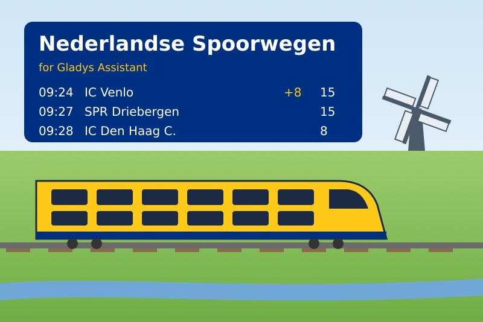
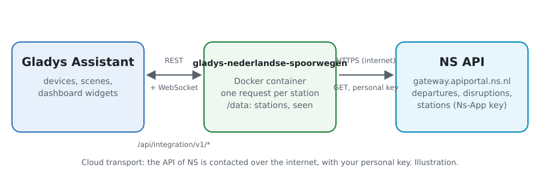
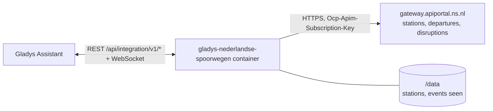
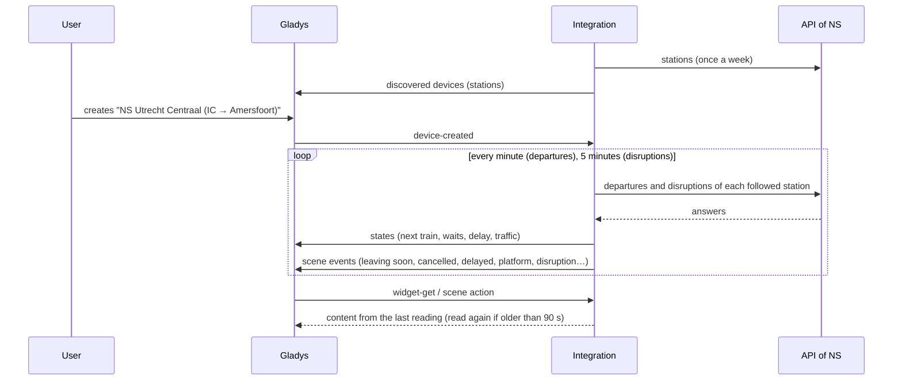
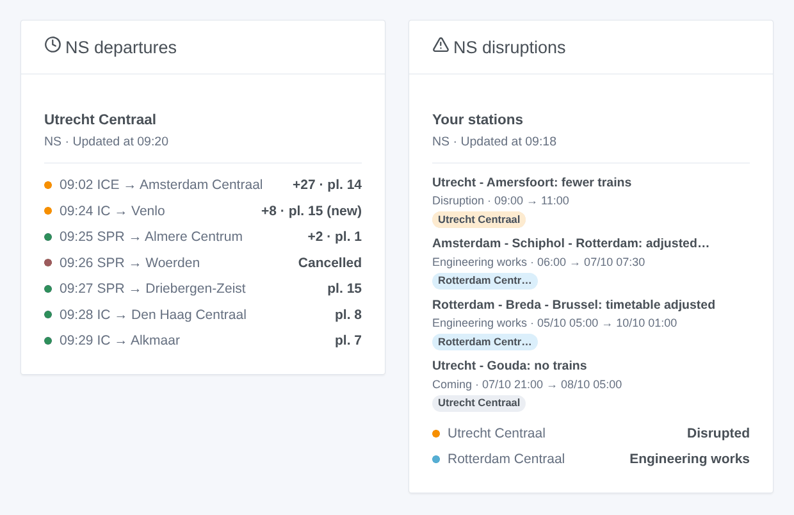

# Gladys Nederlandse Spoorwegen

**English** · [Français](README.fr.md) · [Deutsch](README.de.md) · [Español](README.es.md)

[](LICENSE)
[](https://github.com/William-De71/gladys-nederlandse-spoorwegen/releases)
[](https://github.com/William-De71/gladys-nederlandse-spoorwegen/actions/workflows/release.yml)
[](https://gladysassistant.com)



[Gladys Assistant](https://gladysassistant.com) external integration for **NS**, the Dutch railways: the next trains of your stations in real time, with their delay, their platform and the cancelled ones, and the disruptions and engineering works about your stations, with scenes and dashboard widgets. It reads the official API of NS with your free personal key.

User documentation: [English](docs/en.md) · [Français](docs/fr.md) · [Deutsch](docs/de.md) · [Español](docs/es.md).

> Community integration, not affiliated with nor endorsed by NS (Nederlandse Spoorwegen).

## Features

- **One device per followed station** (three in the form, up to 10 more with the **Add a station** button), typed by code ("UT", "ASD") or by name, and filtered by **train type** ("IC", "SPR") and **direction** (the destination or a station the train calls at): next train with its delay and platform, wait of the next two trains, delay of the next one.
- **The disruptions of each station** on its device: disruptions, engineering works and calamities, in one line, and the number under way.
- **Real time**: the expected time and the delay as NS gives them, the platform changes, the cancelled trains.
- **6 scene triggers**, **2 scene actions** and **2 dashboard widgets** (below).
- One request per followed station, every minute by default (30 s to 5 min, every 10 min at night when no train is announced), disruptions every 5 minutes, always under the 300 requests per 5 minutes NS allows; the stations of NS kept in `/data`.
- Configuration buttons: test the connection, find a station (with its code), add / remove / list stations, diagnostic.
- Four languages everywhere: English, French, German, Spanish.

## How it works





At start, the integration reads the stations of NS (`/nsapp-stations/v3`) and resolves what you typed: "UT", "Utrecht" or "Utrecht Centraal" is the station `UT`, "Den Bosch" the station `HT`. Then it reads the next departures of each followed station (`/reisinformatie-api/api/v2/departures`) on its own timer, one request per station, and keeps the trains of the chosen types and direction; every 5 minutes it reads the disruptions of each station (`/disruptions/v3/station/<code>`). Each reading is compared with the previous one to fire the scene triggers.



### Transport

Cloud only (`"transports": ["cloud"]`): the catalog shows the cloud badge. The integration contacts `gateway.apiportal.ns.nl` with your key; only the followed stations are asked. There is no local alternative, so there is no "prefer the local connection" button.

## Devices and features

| Device         | Feature                      | Category / type              | Values                                                 |
| -------------- | ---------------------------- | ---------------------------- | ------------------------------------------------------ |
| NS \<station\> | Next train                   | `text` / `text`              | "IC 3529 → Venlo · 11 min (+8 min late) · platform 15" |
| NS \<station\> | Wait, wait for the following | `duration` / `integer`       | 0 … 180 min                                            |
| NS \<station\> | Delay                        | `duration` / `integer`       | 0 … 180 min                                            |
| NS \<station\> | Traffic                      | `text` / `text`              | "Disrupted: Utrecht - Amersfoort: fewer trains"        |
| NS \<station\> | Disruptions under way        | `counter-sensor` / `integer` | 0 … 20                                                 |

At night, without any train, the waits keep their last value (a 0 would announce a train now); the delay is published only when NS gives an expected time.

## Scene triggers, actions and widgets



**Scene triggers** (once per transition; the first reading is a reference and fires nothing):

- **Train leaving soon**: a train of a followed station leaves in 2, 5, 10, 15, 20 or 30 minutes, on its expected time. Filters: station, minutes.
- **Train cancelled**: a train of the next two hours at a followed station is cancelled. Filter: station.
- **Train delayed**: the delay of a train of the next two hours reaches 5, 10, 15 or 30 minutes. Filters: station, delay reached.
- **Platform changed**: a train of the next two hours leaves from another platform. Filter: station.
- **Disruption at a station**: a disruption, engineering works or a calamity about a followed station begins. Filters: station, kind.
- **Disruption over**: it is over. Filters: station, kind.

**Scene actions**: **next trains** of a station (train, destination, wait, time, platform, delay, the following one, a sentence) and **disruptions of a station** (state, number, title, details, a sentence).

**Widgets**: **NS departures** (a followed station, several in one list, or any station typed in the settings) and **NS disruptions** (your stations, or the whole Dutch network).

Examples:

- When **the Intercity to Amersfoort leaves Utrecht Centraal in 10 minutes** → light the hall lamp in green.
- When **your train is cancelled**, **15 minutes late** or **moved to another platform** → send `{{triggerEvent.data.summary}}` to your phone.
- Every weekday at 7:30 → **read the next trains** of your station and have the `summary` spoken by the kitchen speaker.

## Requirements

- Gladys Assistant **5.3.0** or later (widgets and scene triggers of external integrations, catalog keywords and countries of Gladys 5.3). Older instances cannot install the integration.
- A free personal key of the NS API: create an account on the [NS API portal](https://apiportal.ns.nl/), subscribe to the **Ns-App** product (free), and copy its primary key.

## Installation

- **From the store** of Gladys (Integrations → External integrations), in one click, once indexed.
- **From the repository URL**: `https://github.com/William-De71/gladys-nederlandse-spoorwegen`.
- **Developer mode**: build the image locally (`docker build -t gladys-nederlandse-spoorwegen .`) and install it from Gladys.

## Configuration

| Field                   | Description                                                                         |
| ----------------------- | ----------------------------------------------------------------------------------- |
| API key                 | The primary key of your "Ns-App" subscription (secret).                             |
| Station (1 to 3)        | A code ("UT", "ASD") or a name ("Utrecht Centraal", "Den Bosch").                   |
| Train types             | "IC", "SPR", "IC \| ICE". Empty: every train.                                       |
| Direction               | Stations the train goes to or calls at: "Amersfoort \| Zwolle". Empty: every train. |
| Reading of the stations | 30 s, 1 min (default), 2 min or 5 min.                                              |
| Language of the texts   | Device names, scene summaries and outputs.                                          |

Buttons: **Test the connection**, **Find a station** (name and code of each station found), **Add a station**, **Remove a station**, **List the stations** (the stations beyond the three of the form, kept in the Gladys configuration) and **Diagnostic** (writes the stations, last trains, disruptions, errors and requests to the Logs tab, never the key).

## Usage

1. Enter your API key and one to three stations — more with **Add a station** — (with their train types and direction if you wish), then save.
2. In the **Discover** tab, create the "NS …" devices.
3. Add the **NS departures** and **NS disruptions** widgets to a dashboard, and build scenes with the triggers above.

## Development

```bash
npm install
npm test                       # node --test, never touches the network
npm run lint && npm run format:check
npx github:GladysAssistant/integration-store . --skip-image-check
scripts/build-cover.sh         # cover.jpg from docs/assets/cover.svg
docs/illustrations/render.sh   # docs/assets/widgets.<lang>.png
node .github/scripts/release.mjs next
```

Locally, the SDK reads `GLADYS_HOST_API_URL`, `GLADYS_INTEGRATION_TOKEN` and `GLADYS_INTEGRATION_SELECTOR`; `NS_API_URL` points the integration to another gateway root (a mock); `DEBUG=gladys-integration-sdk` shows the SDK logs and checks every widget content. The tests use real answers of the NS API, reduced (`test/fixtures/`, recorded by the [perron](https://github.com/ultimatelemon/perron) project, MIT). The rules of the project are in [CLAUDE.md](CLAUDE.md).

## Release process


Every merge on `main` runs the CI, then computes the version from the [Conventional Commits](https://www.conventionalcommits.org/) since the last tag: `feat` → minor, `fix` / `perf` → patch, `!` or `BREAKING CHANGE` → major (a minor below 1.0.0); `docs`, `chore`, `ci`, `test`, `style`, `refactor`, `build` alone publish nothing. The changelog section is generated, the tag pushed, the multi-architecture image built, then `main` receives the release commit, the GitHub Release is created and a last job checks the public image, the store validator and the topic.

- The pull request title becomes the squash commit, then the changelog line: write it in English, for the user (`pr-title.yml` checks it). Never edit `CHANGELOG.md` by hand.
- 1.0.0 is a decision: Actions → Release → Run workflow with `release-as: 1.0.0`. `dry-run` shows the version and the notes without publishing.
- **Protected branch**: the release pushes its commit to `main` with `GITHUB_TOKEN`. With a ruleset on `main` stricter than "no deletion, no force-push", add GitHub Actions to its bypass list (or push through a GitHub App), otherwise the publish job fails with instructions.
- After the first release, make the `ghcr.io` package public (Package settings → Change visibility), or Gladys cannot pull it.

## Troubleshooting

See [docs/en.md](docs/en.md#troubleshooting). Report issues with the versions of Gladys and of the integration, the station concerned, and the lines of the **Diagnostic** button.

## Contributing

Issues and pull requests are welcome. Run `npm run format:check && npm run lint && npm test` before opening a pull request, and keep every external id and stored key unchanged (see [CLAUDE.md](CLAUDE.md)).

## Security

See [SECURITY.md](SECURITY.md): report vulnerabilities privately. The API key is stored as a secret by Gladys, sent only to the NS gateway and never written to the logs; the integration runs read-only, as a non-root user, in its container.

## Screenshots to come

The images above are illustrations, not screenshots. Real screenshots will go in `docs/assets/screenshots/` (PNG, 1280 × 800): `configuration.png`, `discovery.png`, `device.png`, `scene.png`.

## License

[Apache License 2.0](LICENSE) — see also [NOTICE](NOTICE). The stations, departures and disruptions come from the official API of NS, read with your own key under the terms of use of the NS API portal: the widgets show the source and the time of each reading. Thanks to the Gladys documentation and SDK, and to NS for its open API.
